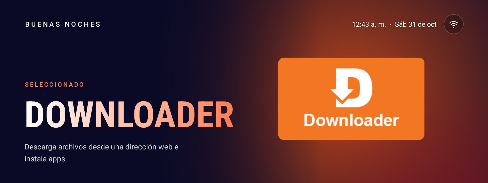

# Cine Home

Una apariencia para el Home de Android TV / Google TV, basada en las soluciones de
[cleanyourtv](https://github.com/Gathin23/cleanyourtv).



> **Cine Home es solo una apariencia. Las soluciones son de
> [cleanyourtv](https://github.com/Gathin23/cleanyourtv), de [Gathin](https://github.com/Gathin23).**
> El método de limpieza, las herramientas ADB y sus controles de seguridad vienen de ese proyecto, bajo licencia MIT.
> Lo que aporta este repositorio es el aspecto del Home y la lista de un **onn. 4K Streaming Box**. Detalle en
> [CREDITS.md](CREDITS.md). No es un proyecto oficial de cleanyourtv, onn., Walmart ni Google.

## Qué hace

- **Home a pantalla completa:** título con degradado en el color de la app seleccionada, fondo fluido y una imagen
  destacada o el logo grande de la app.
- **Canales por páginas:** seis por página en una sola fila, con flechas que indican si hay más.
- **Botón de Wi-Fi** arriba a la derecha.
- **Ligero:** APK de unos 124 KB en Java. Sin permiso de internet, sin servicios en segundo plano, sin desenfoque ni
  video.
- **Limpieza reversible:** las apps se deshabilitan y nunca se desinstalan.

Probado en un onn. 4K Streaming Box (YOC), Google TV 14 (SDK 34), build `URO4.260304.092.16202347`. En otros equipos
debería funcionar con Android 8 o superior, pero no se ha probado.

## Requisitos

- Windows con PowerShell y Python 3.
- Docker Desktop encendido, para compilar sin instalar JDK ni Android SDK.
- En el TV: Ajustes > Sistema > Opciones de desarrollador > **Depuración USB** activa. Acepta el aviso «¿Permitir
  depuración USB?» cuando aparezca.
- El repositorio en una ruta corta, como `C:\cine-home`. Con rutas muy largas falla el cliente ADB de Python.

Una sola vez, desde la carpeta del repositorio:

```powershell
python -m venv tools\venv
tools\venv\Scripts\python.exe -m pip install -r tools\requirements.txt
```

## Instalar

Antes de empezar, guarda el estado del TV como explica el
[procedimiento de cleanyourtv](https://github.com/Gathin23/cleanyourtv/blob/main/PROMPT.md).

### 1. Limpiar por tandas

Revisa primero las listas de [`device/onn-4k`](device/onn-4k): están hechas para un dueño concreto. Quita cualquier
app que uses. Aplica una tanda, mira que el TV siga bien y pasa a la siguiente:

```powershell
powershell -ExecutionPolicy Bypass -File tools\disable.ps1 -TvHost <ip del tv> device\onn-4k\batch-1-telemetry.txt
powershell -ExecutionPolicy Bypass -File tools\disable.ps1 -TvHost <ip del tv> device\onn-4k\batch-2-preloaded.txt
powershell -ExecutionPolicy Bypass -File tools\disable.ps1 -TvHost <ip del tv> device\onn-4k\batch-3-streaming.txt
powershell -ExecutionPolicy Bypass -File tools\disable.ps1 -TvHost <ip del tv> device\onn-4k\batch-4-installed.txt
```

### 2. Instalar el Home

Con Docker Desktop encendido:

```powershell
powershell -ExecutionPolicy Bypass -File scripts\build-and-install.ps1 -TvHost <ip del tv>
```

Compila, instala, comprueba que Home quedó en el launcher nuevo y solo entonces deshabilita el original. Si algo
falla, lo vuelve a activar.

### 3. Última tanda

El asistente de configuración también responde a Home, así que va después del launcher. `disable.ps1` lo omite si es
dueño de tu red Wi-Fi guardada, porque deshabilitarlo te dejaría sin Wi-Fi:

```powershell
powershell -ExecutionPolicy Bypass -File tools\disable.ps1 -TvHost <ip del tv> device\onn-4k\batch-5-setupwraith.txt
```

Reinicia el TV y prueba el control remoto real.

### 4. Cerrar ADB

Apaga la Depuración USB al terminar: el puerto 5555 va sin cifrar. Comprueba después del reinicio que `closed` sea la
respuesta:

```powershell
tools\venv\Scripts\python.exe -I tools\adb-closed.py <ip del tv>
```

## Deshacer todo

```powershell
powershell -ExecutionPolicy Bypass -File scripts\restore.ps1 -TvHost <ip del tv>
```

Rehabilita lo deshabilitado y devuelve Home al launcher original de Google. Usa los registros que `disable.ps1` guardó
en `%USERPROFILE%\.cleanyourtv\`, ligados a la IP del TV y a la ruta de cada lista. Si moviste la carpeta o cambió la
IP, el script avisa y habilita todos los paquetes de las listas, incluidos los que ya estuvieran deshabilitados de
antes.

**Antes de un restablecimiento de fábrica, ejecuta este script.** El asistente y el launcher original deben estar
habilitados.

Para volver a habilitar una sola app:

```powershell
$env:TV_HOST = '<ip del tv>'
tools\venv\Scripts\python.exe -I tools\tv.py "pm enable com.netflix.ninja"
```

## Personalizar

### Canales

Edita [`theme/config.json`](theme/config.json) y aplícalo, sin recompilar:

```powershell
powershell -ExecutionPolicy Bypass -File tools\theme.ps1 -TvHost <ip del tv> theme
```

| Clave | Para qué sirve |
|---|---|
| `dock_apps` | El orden de los canales, seis por página |
| `app_labels` | El nombre de cada canal: `"paquete=Nombre"` |
| `app_descriptions` | El texto bajo el título: `"paquete=Texto"` |
| `app_colors` | El color de una app: `"paquete=#1E3A8A"`. Sin él, se toma de su banner |
| `hidden_apps` | Apps que no se muestran |

Una app nueva con versión para TV aparece sola en la última página. Una sin versión para TV no aparece en el Home, y
se abre desde Ajustes > Apps.

### Imagen destacada

Por defecto cada app muestra su logo grande sobre un resplandor de su color. Para poner una imagen:

1. Guárdala en [`hero/`](hero) con el nombre del paquete de la app, por ejemplo `com.esaba.downloader.jpg`. Puede ser
   `.jpg`, `.png` o `.webp`, de 1920x1080 o similar. Lo importante debe quedar a la derecha.
2. Súbela:

   ```powershell
   powershell -ExecutionPolicy Bypass -File scripts\push-heroes.ps1 -TvHost <ip del tv>
   ```

3. Vuelve al Home desde cualquier app para verla.

La imagen es fija. El launcher no usa internet, así que no muestra novedades ni carteles que cambien.

### Colores del fondo

Están en [`ArtView.java`](launcher/app/src/main/java/com/gathin/tvhome/ArtView.java) y hay que recompilar:

- `BASE`: el azul marino de la izquierda.
- `DEFAULT_COLOR`: el resplandor de las apps sin color propio.
- `PICTURE_LIFT`: cuánto se aclaran las imágenes destacadas.

El acento coral es `accent` en
[`values.xml`](launcher/app/src/main/res/values/values.xml).

## Lo que conviene saber

- **Comparte paquete con el launcher de cleanyourtv:** `com.gathin.tvhome`. Las herramientas lo esperan así, de modo
  que uno sustituye al otro y no pueden convivir.
- **Clave de firma:** el APK se firma con una clave de depuración que vive en el volumen de Docker
  `cleanyourtv-gradle`. Si lo borras, la siguiente instalación falla con `INSTALL_FAILED_UPDATE_INCOMPATIBLE`:
  desinstala primero `com.gathin.tvhome`. Por eso no se publican APK; cada quien compila el suyo.
- **Chromecast:** funcionó con el asistente deshabilitado. YouTube y Netflix no abren por Cast mientras sus apps sigan
  deshabilitadas.
- **Botones del control:** el engranaje y los botones de apps pueden no hacer nada en este Home.
- **Si algo sale mal:** consulta la
  [guía de problemas de cleanyourtv](https://github.com/Gathin23/cleanyourtv/blob/main/docs/TROUBLESHOOTING.md). Los
  mensajes de `disable.ps1` citan esa guía y sus incidencias.

## Seguridad

Las herramientas se niegan a deshabilitar paquetes básicos de Android, y comprueban Home y el Wi-Fi antes de tocarlos.
Aun así, la limpieza es bajo tu responsabilidad, sin garantía. No publiques capturas ni copias de tu TV que muestren
tu Wi-Fi, tu IP, tu cuenta o el número de serie.

## Colaborar

El proyecto es abierto: puedes abrir un issue o enviar un pull request con mejoras al Home, listas para otros TV o
documentación. Empieza por [CONTRIBUTING.md](CONTRIBUTING.md). Lo que afecte a las herramientas o al método de
limpieza va a [cleanyourtv](https://github.com/Gathin23/cleanyourtv).

## Licencia

[MIT](LICENSE). Conserva los avisos de copyright de Gathin y de este proyecto.
